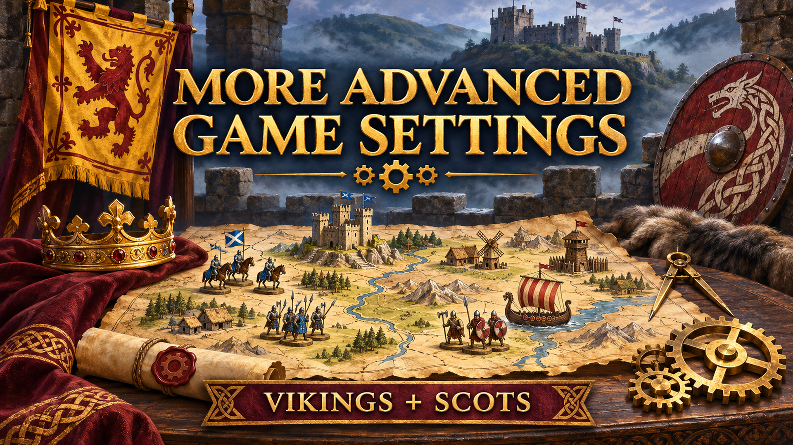

# More Advanced Game Settings

Daniel (TypeDan)'s modified edition of **Advanced Game Settings**, originally created by [Woprok](https://github.com/Woprok/AOE4-AdvancedGameSettings) and continued by [Joshua Sachtleben](https://github.com/joshuasachtleben/AOE4-AdvancedGameSettings). This edition retains their match customization system and adds further options and gameplay changes, including **Empowered Queen**.

## Vikings and Scots compatibility

Updated against Age of Empires IV **17.0.12260** on 9 November 2026:

- Scots and Vikings civilization identifiers, unit/building blueprints and prefixes.
- Technology lists for all four ages, with emplacement and Scottish progression/muster upgrades excluded from blanket age grants.
- Viking generic-technology corrections and a fix to the reversed upgrade-removal guard.

Automated Lua checks pass for civilization lookups, all four technology ages and the removal regression. The mod builds in the native Content Editor. A full original-mode in-game compatibility run remains pending: an existing subscribed edition with the same mod ID can override the local copy. This is not a claim that every game option and multiplayer combination has been playtested.

## Play and build

[Subscribe through the Age of Empires IV mod catalogue](https://www.ageofempires.com/mods/details/517773/), or search for **More Advanced Game Settings** by **TypeEkcyall** in the game. The existing listing was updated on 9 November 2026, retaining its subscribers and ratings.

Download the `.sga` from [Releases](https://github.com/TypeDan/More-Advanced-Game-Settings/releases), and place it in a `More Advanced Game Settings` folder inside your AoE IV user-data `mods/extension/local` directory. Start a new game and select **More Advanced Game Settings** as the **game mode**. This is a game-mode mod; it does not require the Yuletide tuning pack. The optional Empowered Queen setting needs the separate Empowered Queen tuning pack for its queen blueprint.

For source builds, open `More Advanced Game Settings.aoe4mod` in the AoE IV Content Editor and choose **Build Mod (F7)**. The archive is generated in `archives/`. Close the editor before launching the game on the Xbox/Store installation. Check that the intended local version is selected if you also subscribe to an edition sharing this mod ID.

## Origin and changes

The original project supplies features such as alternative starts, victory rules, diplomacy and handicaps. Daniel's edition adds Empowered Queen and the compatibility changes above. See [CREDITS.md](CREDITS.md), the retained source headers and [GPL-3.0 license](LICENSE.md). The new thumbnail is promotional illustration.
