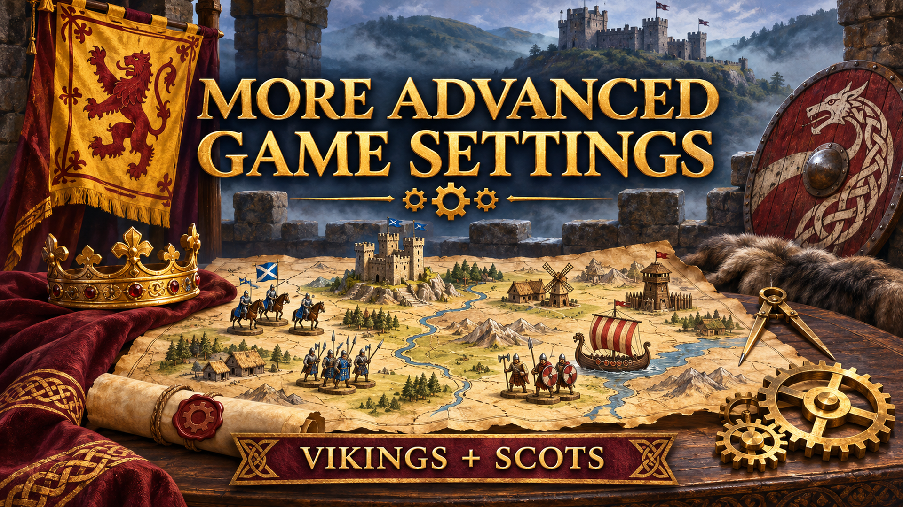

# More Advanced Game Settings

**Published version: 2026.11.27.1.** This label also appears at the start of the mod description.

More options for match rules, starting conditions, diplomacy and handicaps, plus Empowered Queen. Updated for Vikings and Scots.

**Version 2026.11.27.1** brings across Yuletide's shared localization fix: 72 inherited references now use this mod's own text files. The shared population, economy, military and civilization code already matches Yuletide. Christmas mechanics remain specific to Yuletide.

**Version 2026.11.20.1** fixes custom population limits granting all housing immediately. A configured maximum of 250 now preserves normal house requirements. See [validation and coverage](docs/2026-11-20-housing-update.md).

Small text with no background or border just above the bottom-left resource box, with your applied Eco and Military boosts and the game's Pop limit stacked vertically. It appears only when custom bonuses or a custom cap apply. Pending boosts and actual/configured cap mismatches are amber.

## Vikings and Scots compatibility

Updated against Age of Empires IV **17.0.12260** on 9 November 2026:

- Scots and Vikings civilization identifiers, unit/building blueprints and prefixes.
- Technology lists for all four ages, with emplacement and Scottish progression/muster upgrades excluded from blanket age grants.
- Viking generic-technology corrections and a fix to the reversed upgrade-removal guard.

Automated Lua checks pass for civilization lookups, all four technology ages and the removal regression. The mod builds in the native Content Editor. An isolated English match was verified on 27 November 2026 with only this mod installed; the repaired settings text rendered correctly. This is not a claim that every game option and multiplayer combination has been playtested.

## Play and build

[Subscribe through the Age of Empires IV mod catalogue](https://www.ageofempires.com/mods/details/604300/), or search for **More Advanced Game Settings** by **TypeEkcyall** in the game. This is the replacement listing published on 27 November 2026; subscribe to this entry and check for version **2026.11.27.1** in the description. The former listing 593850 was removed after the new publication was verified.

Download the `.sga` from [Releases](https://github.com/TypeDan/More-Advanced-Game-Settings/releases), and place it in a `More Advanced Game Settings` folder inside your AoE IV user-data `mods/extension/local` directory. Start a new game and select **More Advanced Game Settings** as the **game mode**. This is a game-mode mod; it does not require the Yuletide tuning pack. The optional Empowered Queen setting needs the separate Empowered Queen tuning pack for its queen blueprint.

For source builds, open `More Advanced Game Settings.aoe4mod` in the AoE IV Content Editor and choose **Build Mod (F7)**. The archive is generated in `archives/`. Close the editor before launching the game on the Xbox/Store installation. Check that the intended local version is selected if you also subscribe to an edition sharing this mod ID.

## Origin and changes

Based on [Advanced Game Settings by Woprok](https://github.com/Woprok/AOE4-AdvancedGameSettings) and [Joshua Sachtleben’s continuation](https://github.com/joshuasachtleben/AOE4-AdvancedGameSettings). Adds Empowered Queen and the compatibility changes above. See [CREDITS.md](CREDITS.md), the retained source headers and [GPL-3.0 license](LICENSE.md). The new thumbnail is promotional illustration.

## Release numbering

Use `YYYY.MM.DD.N` in `VERSION`, the description entries (IDs 2 and 3) in `assets/locdb/*.csv`, and the GitHub release. Increase `N` for each further release that day. Set the label before the native F7 build, publish through the existing local project, then verify the store description and downloaded archive. The site's own version counter is separate from this release label. Keep project GUIDs and existing store listings when updating; deleting listings is not a normal update step.
